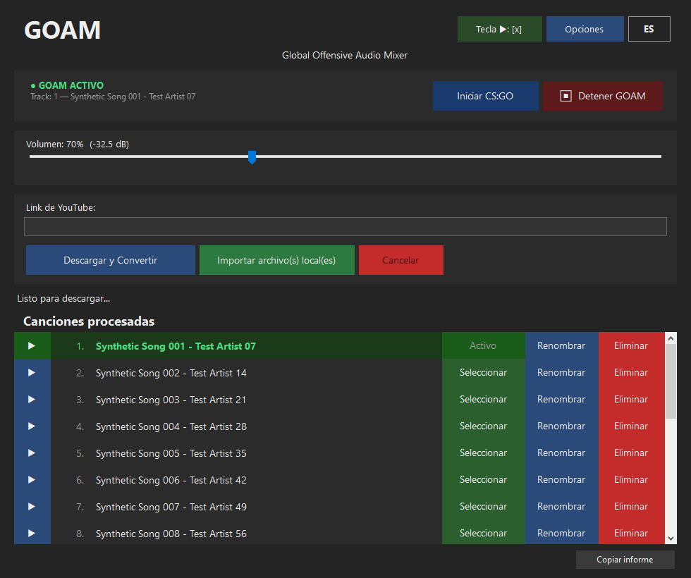

# GOAM — Global Offensive Audio Mixer

[English](README.md) · [Español](README.es.md)

[](https://github.com/TheLucXas/GOAM/actions/workflows/ci.yml)
[](LICENSE)

> **Proyecto no oficial, hecho con ayuda de asistentes de IA y sin afiliación con Valve.**
> GOAM es una herramienta de fans para Counter-Strike: Global Offensive (Legacy). No modifica el juego
> ni sus archivos, salvo los `.cfg` y `voice_input.wav` descritos más abajo.
> **GOAM no distribuye música.** Descargar audio de YouTube puede ir en contra de los términos de servicio
> de YouTube en tu país; eres responsable del contenido que uses y de tener derecho a usarlo.

**GOAM** es una aplicación de escritorio para Windows que reproduce tu propia música por el micrófono en
CS:GO (Legacy, AppID de Steam `4465480`). Es un reemplazo moderno de
[SLAM](https://github.com/SilentSys/SLAM).



## Funciones

- Descarga audio de YouTube (con el `yt-dlp` oficial, que se obtiene y verifica la primera vez)
- Importa archivos locales MP3, WAV, FLAC u OGG
- Vista previa de las canciones antes de usarlas en el juego
- Control de volumen con indicación en dB
- Teclas de reproducción y de relay configurables
- Cambio de canción dentro del juego sin salir de CS:GO
- Renombrar y borrar canciones desde la lista
- Español / inglés (sigue el idioma del sistema, se cambia con un clic)
- Minimizar a la bandeja, inicio opcional con Windows
- Botón *Copiar informe* con datos de diagnóstico (sin datos personales) para reportar problemas

## Requisitos

- Windows 10 u 11 de 64 bits. (Las ediciones N / KN necesitan el *Media Feature Pack* de Microsoft.)
- CS:GO Legacy instalado desde Steam.
- Internet para descargar de YouTube (no hace falta para archivos locales).
- Nada más: la versión publicada es autocontenida, no hay que instalar .NET.

## Instalación

1. Descarga `GOAM.exe` y `SHA256SUMS.txt` desde la página de [Releases](../../releases).
2. Verifica el archivo (PowerShell):

   ```powershell
   Get-FileHash .\GOAM.exe -Algorithm SHA256
   Get-Content .\SHA256SUMS.txt
   ```

   Los dos hashes deben coincidir.
3. Ejecuta `GOAM.exe`. No está firmado digitalmente, por lo que SmartScreen de Windows puede pedir
   confirmación (*Más información → Ejecutar de todas formas*).

## Uso

1. **Primer inicio:** elige dónde guardar las canciones (la carpeta por defecto está bien) y selecciona la
   carpeta de CS:GO (la que contiene `csgo.exe`; GOAM la sugiere si la encuentra en tus bibliotecas de Steam).
2. **Agrega canciones:** pega un enlace de YouTube y pulsa *Descargar y Convertir*, o pulsa
   *Importar archivo(s) local(es)*. Con una playlist, GOAM pregunta si quieres solo el video o toda la lista.
3. **Inicia el juego** con el botón *Iniciar CS:GO* (abre CS:GO con `+exec goam.cfg`), o ejecuta
   `exec goam` en la consola del juego.
4. **En el juego**
   - Pulsa la tecla de reproducción (por defecto `x`) para que suene la música por tu micrófono; pulsa de
     nuevo para detenerla.
   - `li` lista las canciones, `np` muestra la actual.
   - Escribe el número de una canción en la consola (por ejemplo `3`) para cambiarla sin salir del juego.
5. Al cerrar GOAM (o pulsar *Detener GOAM*) se borran los archivos que creó en la carpeta del juego.

Atajos en la lista de canciones: `Enter` seleccionar, `Espacio` vista previa, `F2` renombrar, `Supr` eliminar.

## Cómo funciona

GOAM escribe la canción elegida como `voice_input.wav` en la carpeta de CS:GO — un WAV de **22050 Hz, mono,
PCM de 16 bits**, el único formato que acepta el juego — y genera `csgo\cfg\goam.cfg` (binds y aliases),
`goam_tracks.cfg` y `current_track.cfg`. La tecla de reproducción alterna
`voice_inputfromfile 1; voice_loopback 1; +voicerecord`.

Cada número de canción es un alias que asigna la *tecla relay* a ese número y pide al juego que escriba su
configuración (`host_writeconfig goam_relay_key`). GOAM vigila ese archivo y, cuando cambia, convierte la
canción elegida con el volumen configurado y reemplaza `voice_input.wav`. Más detalles en
[docs/ARCHITECTURE.md](docs/ARCHITECTURE.md).

Dónde queda cada cosa:

| Qué | Dónde |
|---|---|
| Configuración | `%APPDATA%\GOAM\config.json` |
| Registro (rotativo, solo local) | `%APPDATA%\GOAM\logs\goam.log` |
| yt-dlp | `%LOCALAPPDATA%\GOAM\tools\yt-dlp.exe` |
| Canciones | la carpeta que elegiste (por defecto `%APPDATA%\GOAM\Songs`) |

Las variables de entorno `GOAM_DATA_DIR` y `GOAM_TOOLS_DIR` reemplazan la primera y la tercera fila
(útil para uso portable y pruebas).

Si vienes de GOAM 1.x (Python): tu `%APPDATA%\GOAM\config` se lee automáticamente en el primer inicio y se
reutiliza tu carpeta de canciones. El archivo antiguo no se toca.

## Solución de problemas

- **No suena nada en el juego** — Comprueba que GOAM muestre *GOAM ACTIVO*, que iniciaste CS:GO con
  `+exec goam.cfg` (o ejecutaste `exec goam`) y que haya una canción marcada como *Activo*. Pulsa de nuevo
  la tecla de reproducción si el juego ya tenía el micrófono tomado.
- **Los números de canción no hacen nada** — El archivo de relay solo existe después de que el juego lo
  escribe una vez; revisa en Opciones que la tecla relay no choque con otra. *Copiar informe* indica si se
  encontraron Steam y el archivo de relay.
- **Falla la descarga de YouTube** — GOAM actualiza `yt-dlp` automáticamente y reintenta una vez. Si
  YouTube cambió algo muy reciente, inténtalo más tarde o instala [Deno](https://deno.com) (yt-dlp lo usa
  para resolver los desafíos de JavaScript de YouTube).
- **"Formato no compatible"** — Solo se importan MP3, WAV, FLAC y OGG. Un archivo dañado o la falta de
  códecs de Windows (ediciones N) muestran el mismo mensaje.
- **El antivirus / firewall pregunta por yt-dlp** — `yt-dlp.exe` es la versión oficial, verificada contra
  el checksum publicado con su release de GitHub.

Para pedir ayuda, abre un issue y pega el resultado de **Opciones → Copiar informe**.

## Preguntas frecuentes

**¿Lo permite VAC?** GOAM solo escribe archivos `.cfg` y un archivo de audio que el propio juego lee mediante
una variable de consola documentada. Aun así, úsalo bajo tu responsabilidad y respeta las reglas de los
servidores donde juegas.

**¿Envía datos?** No. GOAM no tiene telemetría. El único tráfico de red es hacia GitHub (para obtener y
actualizar `yt-dlp.exe`) y hacia YouTube a través de yt-dlp cuando pides una descarga.

**¿Por qué el archivo es grande?** La versión publicada incluye el runtime de .NET para que no haya que
instalar nada.

## Compilar desde el código fuente

Requiere el [SDK de .NET 8](https://dotnet.microsoft.com/download/dotnet/8.0) en Windows.

```powershell
dotnet build GOAM.sln -c Release
dotnet test  tests/GOAM.Core.Tests -c Release
dotnet publish src/GOAM.App -c Release -r win-x64 --self-contained true `
  -p:PublishSingleFile=true -p:EnableCompressionInSingleFile=true -o out
```

Consulta [CONTRIBUTING.md](CONTRIBUTING.md) para el flujo de desarrollo y
[docs/PERFORMANCE.md](docs/PERFORMANCE.md) para las mediciones frente a la versión 1.x en Python.

La última versión en Python (1.x) sigue disponible en la etiqueta
[`v1.x-python-final`](../../tree/v1.x-python-final).

## Créditos

- [SLAM](https://github.com/SilentSys/SLAM) — la inspiración original
- [yt-dlp](https://github.com/yt-dlp/yt-dlp), [NAudio](https://github.com/naudio/NAudio),
  [NVorbis](https://github.com/NVorbis/NVorbis) — ver [THIRD_PARTY_NOTICES.md](THIRD_PARTY_NOTICES.md)
- Hecho con ayuda de asistentes de IA (ChatGPT, Grok, Claude)

Publicado en dominio público bajo [The Unlicense](LICENSE).
