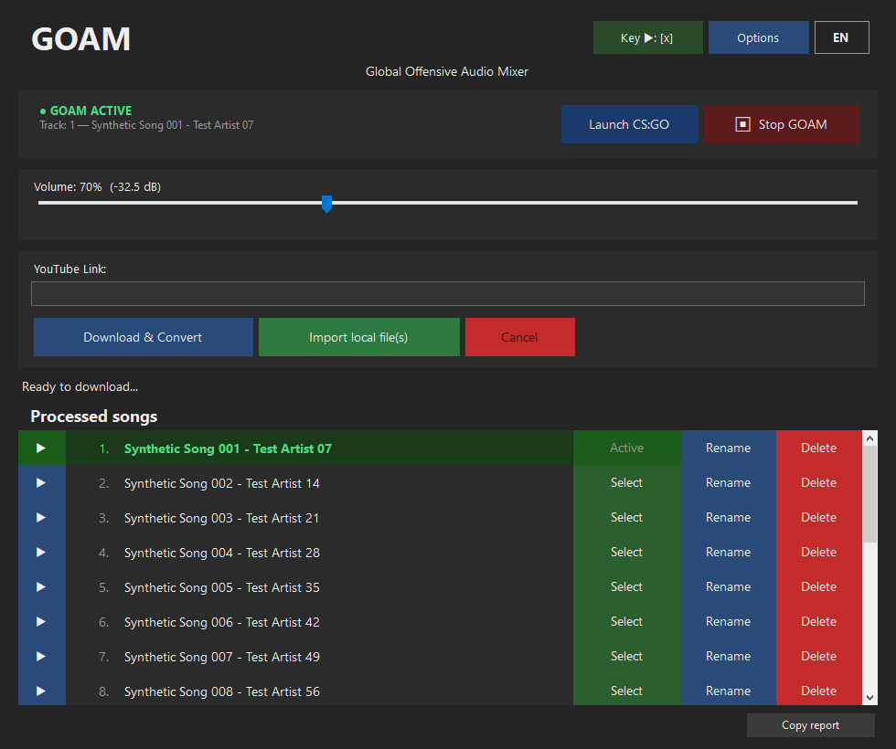

# GOAM — Global Offensive Audio Mixer

[English](README.md) · [Español](README.es.md)

[](https://github.com/TheLucXas/GOAM/actions/workflows/ci.yml)
[](LICENSE)

> **Unofficial project, made with the help of AI assistants, and not affiliated with Valve.**
> GOAM is a fan-made tool for Counter-Strike: Global Offensive (Legacy). It does not modify the game
> or its files other than the `.cfg` files and `voice_input.wav` described below.
> **No music is distributed with GOAM.** Downloading audio from YouTube may go against YouTube's terms of
> service in your country; you are responsible for the content you use and for having the right to use it.

**GOAM** is a Windows desktop app that plays your own music through your microphone in
CS:GO (Legacy, Steam AppID `4465480`). It is a modern replacement for
[SLAM](https://github.com/SilentSys/SLAM).



## Features

- Download audio from YouTube (through the official `yt-dlp`, fetched and verified on first use)
- Import local MP3, WAV, FLAC or OGG files
- Preview songs before playing them in-game
- Volume control with a dB readout
- Configurable play key and relay key
- Switch songs in-game without leaving CS:GO
- Rename and delete songs from the list
- Spanish / English (follows your system language, switchable with one click)
- Minimize to the system tray, optional start with Windows
- A *Copy report* button that gathers diagnostic information (no personal data) for bug reports

## Requirements

- Windows 10 or 11, 64-bit. (N / KN editions need Microsoft's *Media Feature Pack*.)
- CS:GO Legacy installed through Steam.
- Internet access for YouTube downloads (not needed for local files).
- Nothing else: the release is self-contained, there is no .NET to install.

## Install

1. Download `GOAM.exe` and `SHA256SUMS.txt` from the [Releases](../../releases) page.
2. Verify the file (PowerShell):

   ```powershell
   Get-FileHash .\GOAM.exe -Algorithm SHA256
   Get-Content .\SHA256SUMS.txt
   ```

   The two hashes must match.
3. Run `GOAM.exe`. It is not code-signed, so Windows SmartScreen may ask for confirmation
   (*More info → Run anyway*).

## Using GOAM

1. **First start:** choose where songs are stored (the default is fine) and select your CS:GO folder
   (the one that contains `csgo.exe`; GOAM suggests it when it finds it in your Steam libraries).
2. **Add songs:** paste a YouTube link and press *Download & Convert*, or press *Import local file(s)*.
   Playlists ask whether you want the single video or the whole list.
3. **Start the game** with the *Launch CS:GO* button (it starts CS:GO with `+exec goam.cfg`), or run
   `exec goam` in the in-game console.
4. **In the game**
   - Press the play key (default `x`) to start the music through your microphone, press it again to stop.
   - `li` lists the songs, `np` shows the current one.
   - Type a song number in the console (for example `3`) to switch songs without alt-tabbing.
5. Closing GOAM (or pressing *Stop GOAM*) removes the files it created in the game folder.

Keyboard shortcuts in the song list: `Enter` select, `Space` preview, `F2` rename, `Delete` remove.

## How it works

GOAM writes the chosen song as `voice_input.wav` in the CS:GO folder — a WAV of **22050 Hz, mono, 16-bit
PCM**, the only format the game accepts — and generates `csgo\cfg\goam.cfg` (binds and aliases),
`goam_tracks.cfg` and `current_track.cfg`. The play key toggles
`voice_inputfromfile 1; voice_loopback 1; +voicerecord`.

Each song number is an alias that binds the *relay key* to that number and asks the game to write its
config (`host_writeconfig goam_relay_key`). GOAM watches that file and, when it changes, converts the
selected song with the volume you set and replaces `voice_input.wav`. More details in
[docs/ARCHITECTURE.md](docs/ARCHITECTURE.md).

Where things live:

| What | Where |
|---|---|
| Settings | `%APPDATA%\GOAM\config.json` |
| Log (rotating, local only) | `%APPDATA%\GOAM\logs\goam.log` |
| yt-dlp | `%LOCALAPPDATA%\GOAM\tools\yt-dlp.exe` |
| Songs | the folder you chose (default `%APPDATA%\GOAM\Songs`) |

Environment variables `GOAM_DATA_DIR` and `GOAM_TOOLS_DIR` replace the first and third rows
(useful for portable use and testing).

Upgrading from GOAM 1.x (Python): your `%APPDATA%\GOAM\config` is read automatically on first start and
your songs folder is reused. The old file is left untouched.

## Troubleshooting

- **Nothing plays in-game** — Make sure GOAM shows *GOAM ACTIVE*, that you started CS:GO with
  `+exec goam.cfg` (or ran `exec goam`), and that a song is marked *Active*.
- **Song numbers do nothing in-game** — The relay file only exists after the game has written it once;
  open Options and check the relay key matches an unused key. *Copy report* shows whether Steam and the
  relay file were found.
- **YouTube download fails** — GOAM updates `yt-dlp` automatically and retries once. If YouTube changed
  something very recent, try again later or install [Deno](https://deno.com) (yt-dlp uses it to solve
  YouTube's JavaScript challenges).
- **"Unsupported format"** — Only MP3, WAV, FLAC and OGG are imported. A damaged file or a missing
  Windows media codec (N editions) gives the same message.
- **Antivirus / firewall prompts for yt-dlp** — `yt-dlp.exe` is the official build, verified against the
  checksum published with its GitHub release.

When asking for help, open an issue and paste the output of **Options → Copy report**.

## FAQ

**Is this allowed by VAC?** GOAM only writes `.cfg` files and an audio file the game itself reads
through a documented console variable. Still, use it at your own risk and follow the rules of the servers
you play on.

**Does it send any data?** No. GOAM has no telemetry. The only network traffic is to GitHub (to fetch and
update `yt-dlp.exe`) and to YouTube through yt-dlp when you ask for a download.

**Why is the file big?** The release bundles the .NET runtime so nothing has to be installed.

## Building from source

Requires the [.NET 8 SDK](https://dotnet.microsoft.com/download/dotnet/8.0) on Windows.

```powershell
dotnet build GOAM.sln -c Release
dotnet test  tests/GOAM.Core.Tests -c Release
dotnet publish src/GOAM.App -c Release -r win-x64 --self-contained true `
  -p:PublishSingleFile=true -p:EnableCompressionInSingleFile=true -o out
```

See [CONTRIBUTING.md](CONTRIBUTING.md) for the development workflow and
[docs/PERFORMANCE.md](docs/PERFORMANCE.md) for measurements against the 1.x Python version.

The final Python release (1.x) remains available at the
[`v1.x-python-final`](../../tree/v1.x-python-final) tag.

## Credits

- [SLAM](https://github.com/SilentSys/SLAM) — the original inspiration
- [yt-dlp](https://github.com/yt-dlp/yt-dlp), [NAudio](https://github.com/naudio/NAudio),
  [NVorbis](https://github.com/NVorbis/NVorbis) — see [THIRD_PARTY_NOTICES.md](THIRD_PARTY_NOTICES.md)
- Built with the help of AI assistants (ChatGPT, Grok, Claude)

Released into the public domain under [The Unlicense](LICENSE).
